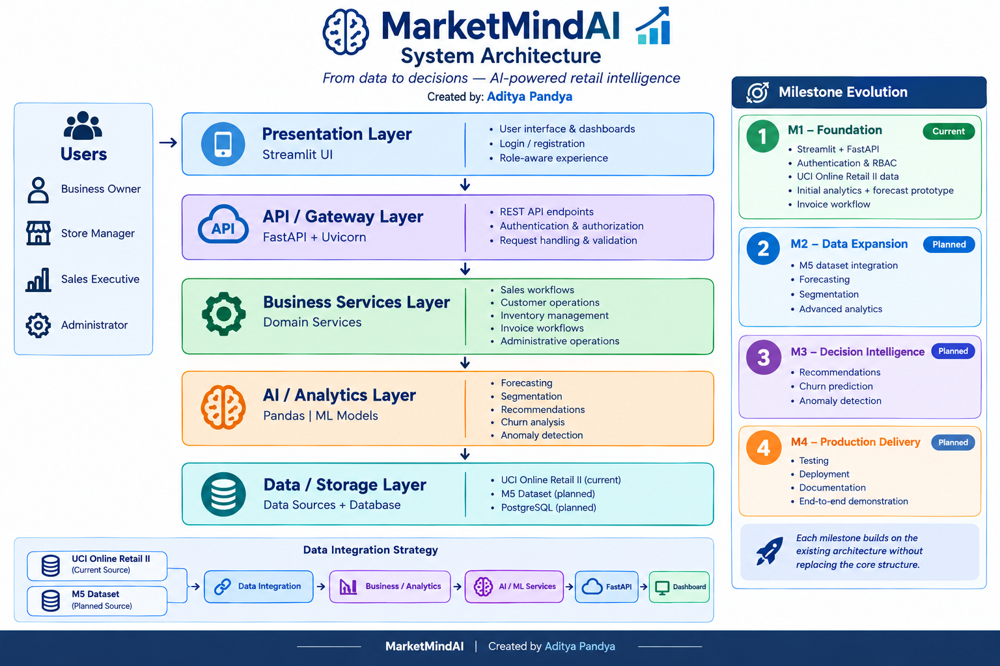

# MarketMindAI

## Small Business Sales Intelligence Platform

**Author:** Aditya Pandya  
**Internship:** Infosys-Springboard Internship Project  
**Current milestone:** Milestone 4 — UI polish and final presentation  
**Repository branch:** `aditya-pandya-milestone-4`
**Execution mode:** Local development (not publicly deployed)

---

## 1. Executive Overview

**MarketMindAI** is a growing sales-intelligence platform designed to help small and medium-sized retail businesses turn operational data into actionable business information.

The platform has progressed through the four internship milestones. The current repository includes a React/TypeScript web frontend, FastAPI backend, authentication and role-based access control, PostgreSQL/SQLAlchemy persistence, UCI Online Retail II and Walmart M5 data workflows, sales analytics, forecasting, customer segmentation, recommendations, churn prediction, anomaly detection, invoice and inventory workflows, and milestone validation artifacts. The application is currently run locally; a public production deployment is not claimed.

The architecture is intentionally being kept extensible so later milestones can add advanced analytics, forecasting, customer intelligence, recommendations, anomaly detection, and production deployment without replacing the approved application structure.

> **Documentation principle:** implemented, prototype, and planned functionality are explicitly distinguished.
---

## 2. Project Vision

MarketMindAI is intended to evolve from a basic retail analytics application into a unified business-intelligence platform covering:

- sales intelligence
- customer intelligence
- demand and revenue forecasting
- inventory intelligence
- invoicing workflows
- role-based dashboards / business dashboards
- AI/ML-driven recommendations
- churn and anomaly insights
- reporting and deployment

The project is being developed milestone by milestone so that each stage provides a usable foundation for the next.

---

## 3. Milestone Roadmap

| Milestone | Focus | Status                                                                  |
|---|---|-------------------------------------------------------------------------|
| **M1** | Application foundation, authentication, RBAC, sales analytics, invoices | ✅ Completed                                                             |
| **M2** | Forecasting, customer segmentation, M5 data workflows | ✅ Completed                                                             |
| **M3** | Product recommendations, churn prediction, anomaly detection | ✅ Completed in repository; model quality is documented in reports       |
| **M4** | Validation, error handling, documentation, UI polish and final demonstration | ✅ Polish; local run, deployment and final                               |


## 4. Architecture



> Visual Architecture of
*MarketMindAI system architecture — Created by Aditya Pandya*
### 4.1 Long-term target architecture

```text
                         User
                           │
                           ▼
                Presentation Layer
              Streamlit / React UI
                           │
                           ▼
                 API / Gateway Layer
                        FastAPI
                           │
                           ▼
                Business Services Layer
          Sales | Customers | Inventory | Invoices
                           │
                           ▼
                  AI / Analytics Layer
       Forecasting | Segmentation | Recommendations
              Churn | Anomaly Detection
                           │
                           ▼
                  Data / Storage Layer
        PostgreSQL + approved source datasets

```
### 4.2 Detailed Architecture Documentation

See [`docs/architecture/architecture.md`](docs/architecture/architecture.md) for the detailed architecture, layer responsibilities, data integration strategy, and milestone evolution.
### 4.3 Detailed Design

- [System Architecture Documentation](docs/architecture/architecture.md)
- [Visual Architecture Diagram](docs/architecture/marketmindai-system-architecture.png)
### 4.4 Current application implementation

The current application uses the following high-level flow:

```text
User
  │
  ▼
React / TypeScript Frontend
  │
  ▼
FastAPI Backend
  │
  ├── Authentication / RBAC
  ├── Sales Summary
  ├── Forecast Prototype
  ├── Invoice Workflow
  └── Admin User View
  │
  ▼
UCI Online Retail II + Walmart M5 source data and derived artifacts
  │
  ▼
Pandas / ML services + PostgreSQL persistence and analytical artifacts
```

The distinction is important: the target architecture describes how the platform is intended to evolve; it should not be read as a claim that every target layer is already implemented in M1.

---

## 5. Technology Stack

| Area | Technology | Current role |
|---|---|---|
| Language | Python | Application and data-processing language |
| Frontend | React + TypeScript | Current web dashboard and authentication UI |
| Backend | FastAPI | REST API and application backend |
| Server | Uvicorn | Local ASGI server |
| Data processing | Pandas | CSV loading and analytics |
| Authentication | JWT | Bearer-token authentication |
| Password security | bcrypt | Password hashing |
| Validation | Pydantic | Request/model validation |
| Current data source | UCI Online Retail II | M1 transaction foundation |
| Additional data source | Walmart M5 | Demand/forecasting workflows introduced in M2 |
| Database | PostgreSQL + SQLAlchemy | Application persistence and ORM integration |
| Version control | Git + GitHub | Source control and milestone collaboration |

---

## 6. Implemented Platform Capabilities

### Authentication

- User registration endpoint
- Login endpoint
- JWT access-token generation
- Bearer-token protected API requests
- Password hashing with bcrypt

### Role-Based Access Control

The current application models the following roles:

- `business_owner`
- `store_manager`
- `sales_executive`
- `admin`

Backend authorization dependencies are used to restrict protected endpoints according to role.

### Sales Intelligence

The current backend loads the two UCI-derived CSV source files and prepares a cached analytical summary including:

- total revenue
- total valid orders
- top product by quantity

### Forecast Prototype

The current application exposes a revenue-forecast route and presents sample forecast-trend output in the Streamlit interface.

This is documented as a **prototype/initial implementation**, not as a validated production forecasting model.

### Invoice Workflow

The current interface exposes:

- invoice viewing workflow
- invoice creation workflow

These are part of the M1 application foundation and still require persistence/production hardening in later stages.

### Administration

An administrative endpoint provides a basic view of registered user profiles for authorized users.

---

## 7. Data Architecture

### 7.1 Milestone 1 — UCI Online Retail II

The platform uses UCI Online Retail II transaction data and maintains Walmart M5 as a distinct source for demand forecasting. Source identifiers and dataset semantics should remain separate.

Relevant source attributes include:

- invoice number
- stock/product code
- product description
- quantity
- invoice date
- unit price
- customer identifier
- country

The source files are retained as project data inputs and processed by the backend at startup.

### 7.2 Milestone 2 — Walmart M5

M5 is used as a separate data source for demand and forecasting analysis.

The integration strategy should preserve:

- source identity
- original source identifiers
- dataset-specific semantics
- provenance
- transformation history

The platform should integrate the datasets at the application/data-service level instead of blindly concatenating their raw rows.

---

## 8. Data Governance and Provenance

MarketMindAI distinguishes between:

### Observed source data

Values directly available in the source dataset.

### Derived analytics

Values calculated from observed transaction data, such as:

- revenue
- order counts
- top-product calculations
- aggregated product/customer metrics

### Estimated inventory

M1 does not contain verified physical stock-count records.

The current inventory concept is therefore an **estimate derived from sales**, rather than observed warehouse stock.

The documented M1 estimation approach is:

```text
Initial Stock = Total Units Sold × 1.5

Estimated Remaining Stock =
    Initial Stock − Total Units Sold
```

These figures must be presented as estimates and should not be represented as verified physical inventory.

---

## 9. Project Structure

```text

marketmindai/                                      # Root directory of the MarketMindAI project
│
├── backend/                                       # Backend application, data processing, and business logic
│   ├── main.py                                    # Main Python application entry point; handles core application logic
│   ├── online_retail_v1.csv                       # First version of the UCI Online Retail II dataset
│   ├── online_retail_v2.csv                       # Second version of the UCI Online Retail II dataset
│   └── preview_milestone2.py                      # Preview application for demonstrating planned Milestone 2 features
│
├── docs/                                          # Project documentation and visual evidence
│   │
│   ├── screenshots/                               # Application screenshots for project demonstration and evaluation
│   │   ├── 01-login.png                           # Login interface screenshot
│   │   ├── 02-create-login.png                    # User registration or account creation interface
│   │   ├── 03-dashboard.png                       # Main dashboard displaying business overview and KPIs
│   │   ├── 04-sales-analytics.png                 # Sales analytics and business performance visualization
│   │   ├── 05-forecast.png                        # Sales forecasting interface and predicted results
│   │   ├── 06-invoice.png                         # Invoice generation or invoice management interface
│   │   ├── 07-rbac-admin.png                      # Role-Based Access Control (RBAC) administration interface
│   │   └── 08-milestone-1-preview.png             # Screenshot demonstrating the Milestone 1 project preview
│   │
│   └── architecture/                              # System architecture documentation and diagrams
│   │   ├── architecture.md                        # Written explanation of the system architecture and components
│   │   └── marketmindai-system-architecture.png   # Visual representation of the MarketMindAI system architecture
│   └── milestone-1.md                             # About Milestone-1
├── frontend/                                      # Frontend application and user interface
│   └── app.py                                     # Python-based frontend application entry point
│
├── .gitignore                                     # Specifies files and folders excluded from Git version control
│
└── README.md                                      # Project overview, setup instructions, features, and usage documentation
```
Repository metadata, Python virtual environments, cache files, and environment secrets are excluded through `.gitignore`.
The repository intentionally keeps the current M1 structure simple. Additional modules should be introduced only when required by the approved milestone architecture and actual implementation needs.

## 9.1 Documentation Map

| Document | Purpose |
|---|---|
| `README.md` | Main project overview and navigation |
| `docs/architecture/architecture.md` | Layered architecture, data integration strategy, and milestone evolution |
| `docs/screenshots/` | Milestone evidence and UI screenshots |

> Future documentation can be added under `docs/` as the platform grows without restructuring the application itself.
---

## 10. API Surface — Current Repository

| Method | Endpoint | Purpose |
|---|---|---|
| `POST` | `/register` | Register a user |
| `POST` | `/login` | Authenticate a user and issue a JWT |
| `GET` | `/sales/summary` | Return current sales KPI summary |
| `GET` | `/forecast/revenue` | Return forecast prototype output |
| `GET` | `/invoices/view` | View invoice workflow |
| `POST` | `/invoices/create` | Create invoice workflow entry |
| `GET` | `/admin/users` | Authorized administrative user view |

Protected endpoints require a valid bearer token and, where applicable, an authorized role.

---

## 11. Security Model

The M1 foundation includes:

```text
User
  │
  ├── Register
  │
  └── Login
        │
        ▼
     JWT Token
        │
        ▼
 Authorization Header
        │
        ▼
 FastAPI Authentication Dependency
        │
        ▼
 Role Validation
        │
        ▼
 Protected Endpoint
```

Security hardening planned for later iterations includes:

- moving secrets out of source code
- persistent user storage
- stronger administration controls
- production CORS configuration
- broader security testing
- deployment-specific secret management

---

## 12. Current Limitations

The repository intentionally documents known limitations rather than presenting prototype behavior as production functionality.

Current M1 limitations include:

- user data is currently maintained in application memory rather than persistent database storage
- source analytics are CSV-based
- PostgreSQL application integration remains a subsequent integration step
- forecasting is a prototype/initial output and requires validation
- invoice workflows require persistence and fuller validation
- inventory values are estimates rather than physical stock counts
- production secret/configuration hardening remains to be completed
- broader automated testing and deployment are planned for later milestones

---

## 13. Milestone Implementation Matrix

| Capability | M1 | M2 | M3 |               M4                |
|---|:---:|:---:|:---:|:-------------------------------:|
| Authentication and RBAC | ✅ | Enhance | Enhance |        Validate / polish        |
| Sales analytics and inventory preview | ✅ | Enhance | Extend |        Validate / polish        |
| PostgreSQL / SQLAlchemy | — | ✅ | Extend |            Validate             |
| Revenue and demand forecasting | Prototype | ✅ | Enhance |            Validate             |
| Walmart M5 workflows | — | ✅ | Extend |            Validate             |
| Customer segmentation | — | ✅ | Extend |            Validate             |
| Product recommendations | — | — | ✅ |            Validate             |
| Churn prediction | — | — | ✅ |            Validate             |
| Anomaly detection | — | — | ✅ |            Validate             |
| Error handling / test reports | — | — | — |       ✅ artifacts present       |
| Login and dashboard polish | — | — | — |    ✅  Polish and Deployment     |
| Public deployment | — | — | — | Not claimed / verify separately |

**Legend**

- ✅ Implemented
- 🟡 Prototype / validation or hardening required
- 🔵 Planned / not yet verified
- — Not part of the current milestone scope

---

## Demo Accounts (Local Development)

The repository's `backend/seed_admin.py` creates **one administrator account only when** `ADMIN_EMAIL` and `ADMIN_PASSWORD` environment variables are set. It does not automatically create all four roles shown in the administration screenshot. Register or seed the other demo users through the application's supported workflow before capturing role-specific screenshots.

Fill these values after creating and testing the accounts locally. Use disposable demo passwords only; do not publish real or reused passwords in a public GitHub repository.

| Role | Demo email | Demo password   |
|---|---|-----------------|
| Admin | `admin@gmail.com` *(verify/create locally)* | `aditya1234567` |
| Business Owner | `businessowner@gmail.com` *(verify/create locally)* | `aditya124567`  |
| Store Manager | `storemanager@gmail.com` *(verify/create locally)* | `aditya1234567` |
| Sales Executive | `salesexecutive@gmail.com` *(verify/create locally)* | `aditya1234567` |

**Important:** the email addresses above are based on the uploaded admin-table screenshot, not proof that those accounts already exist in the database. Confirm each account and role before publishing the README. Passwords are intentionally left as placeholders because the project seed script reads the admin credentials from environment variables and no verified default passwords were found in the uploaded source.

---

## 14. Local Setup

### Prerequisites

- Python 3.x
- Git
- PyCharm or another Python IDE
- Required Python packages for the backend/frontend

### Backend

```powershell
cd backend
python -m uvicorn main:app --reload
```

The FastAPI backend runs locally on:

```text
http://127.0.0.1:8000
```

### Frontend (React + TypeScript)

Open a second terminal:

```powershell
cd frontend\react-app
npm install
npm run dev
```

Use the local URL printed by the frontend development server. Configure its API base URL for the local FastAPI backend. The backend API is available through:

```text
http://127.0.0.1:8000
```

---

## 15. Development Workflow

The repository follows a milestone-based development approach:

```text
Design
  ↓
Implementation
  ↓
Validation
  ↓
Documentation
  ↓
Milestone Review
  ↓
Next-Milestone Extension
```

The architecture is intended to remain stable while individual capabilities are expanded.

---

## 16. Engineering Principles

MarketMindAI follows these principles:

1. **Preserve the approved architecture.**
2. **Separate source data from derived analytics.**
3. **Maintain dataset provenance.**
4. **Do not present estimates as observed facts.**
5. **Document implemented versus planned functionality clearly.**
6. **Prefer incremental, testable improvements over unnecessary complexity.**
7. **Keep the repository maintainable as the project grows across milestones.**

---

## 17. Future Platform Direction

The planned evolution is:

```text
M1 - Foundation
   ↓
M2 - Data Expansion + Forecasting + Segmentation
   ↓
M3 - Decision Intelligence
     │
     ├── Recommendations
     ├── Churn
     └── Anomaly Intelligence
   ↓
M4 - Production Delivery
     │
     ├── Testing
     ├── Deployment
     └── Final Demonstration
```

The long-term goal is a single role-aware business-intelligence platform in which operational retail data feeds analytics and AI capabilities through a consistent application architecture.

---

## 18. Milestone Evidence

Each milestone should be supported by verifiable repository and project evidence, such as:

- source code
- architecture documentation
- authentication screenshots
- sales analytics evidence
- forecast prototype evidence
- invoice workflow evidence
- RBAC/authorization evidence
- data documentation
- API behavior
- dashboard screenshots
- validation/test results
- milestone reports
- implementation notes

The repository README is intended to remain the central navigation document as the project evolves.

---

## 19. Status

**Current repository stage: Milestone 4 — UI polish and final presentation**

The repository contains implementation and artifacts for M1–M4. Milestone 4 focus requested for the README screenshots is limited to the polished login page and main dashboard. The project runs locally; do not interpret this as a public deployment claim.

**Remaining verification:** start the application locally, verify login and dashboard behavior, confirm demo-account provisioning, and capture fresh browser screenshots before marking the presentation fully verified.

## Milestone Evidence and Website Screenshots

Screenshots below should be captured from the **running local website** (not mockups). Add the image files to `docs/screenshots/` and keep the filenames in this table consistent with the files committed to GitHub. Do not mark an image as available until the file has been added.

### Milestone 1 — Foundation Evidence

The following screenshot paths are retained from the original README. Confirm each file exists in the repository before relying on it as evidence.

| Area | Evidence |
|---|---|
| Login | [Login](docs/screenshots/01-Login.png) |
| Registration | [Create-Login](docs/screenshots/08-create-login.png) |
| Dashboard | [Dashboard](docs/screenshots/02-dashboard.png) |
| Sales Analytics | [Sales-Analytics](docs/screenshots/03-sales-analytics.png) |
| Forecast Prototype | [Forecast](docs/screenshots/04-forecast.png) |
| Invoice Workflow | [Invoice](docs/screenshots/05-invoice.png) |
| RBAC / Admin | [RBAC-Admin](docs/screenshots/06-rbac-admin.png) |
| M1 Preview | [Milestone-1 Preview](docs/screenshots/07-milestone-1-preview.png) |

For the detailed requirement-to-evidence mapping, see [`docs/milestone-1.md`](docs/milestone-1.md).

### Milestone 2 — React Frontend and Analytics Evidence

The Milestone 2 evidence record reports that the React login and dashboard screenshots were captured. Keep these alongside the M1 images; do not overwrite earlier evidence. The paths below follow the M2 evidence document and should be checked against the actual filenames in the repository.

| Area | Evidence                                                | Evidence note |
|---|---------------------------------------------------------|---|
| React login | [Login](docs/screenshots/09-M2-React-Login.png)         | Existing M2 login capture; verify file and case-sensitive path |
| React dashboard | [Dashboard](docs/screenshots/10-M2-React-Dashboard.png) | Existing M2 dashboard capture; verify file and case-sensitive path |
| Milestone 2 report | [Report](docs/milestone-2.md)                           | Evidence record, verification notes, and submission checklist |

If screenshot files use different names in your branch, update these paths to match the exact committed filenames. The M2 evidence report notes that login/dashboard captures were recorded, while other feature screenshots and final requirement checks still needed confirmation; screenshot availability alone does not prove every M2 requirement is complete.

### Milestone 3 — Decision Intelligence

| Area | Screenshot                                                                  | Credit |
|---|-----------------------------------------------------------------------------|---|
| Product recommendations | [Product Recommendation](docs/screenshots/18-M3-Product-Recommendation.png) | Screenshot captured by Aditya Pandya |
| Customer churn prediction | [Chrun Prediction](docs/screenshots/19-M3-Chrun-Prediction.png)             | Screenshot captured by Aditya Pandya |
| Anomaly detection | [Aerts](docs/screenshots/20-M3-Anomaly-Detection-Alert.png)                 | Screenshot captured by Aditya Pandya |

### Milestone 4 — UI Polish Only

As requested, M4 screenshot evidence is limited to the polished login page and main dashboard.

| Area | Screenshot                                                               | Credit |
|---|--------------------------------------------------------------------------|---|
| Polished login page | [Polished Login](docs/screenshots/21-M4-Login-Polished.png)              | Screenshot captured by Aditya Pandya |
| Polished main dashboard | [Polished Dashboard](docs/screenshots/22-M4-Polished-Main-Dashboard.png) | Screenshot captured by Aditya Pandya |

When screenshots are added, display them in GitHub Markdown using relative paths, for example: ``. The image supplied during this README update shows the admin user table; it can be saved as `docs/screenshots/admin-users.png` if you want to include it as supporting administration evidence.

## Project Presentation

Use this section to share the MarketMindAI project presentation. Add your PDF or PowerPoint file to the repository and replace the placeholder below with its relative path.

| Resource | Link                                                            |
|---|-----------------------------------------------------------------|
| Project presentation slides (PDF or PPT) | [Final Presentation](docs/presentation/[MarketMindAI_Final_Presentation_Milestones_1_to_4.pptx](docs/presentation/MarketMindAI_Final_Presentation_Milestones_1_to_4.pptx))                        |

## The presentation can summarize the project objective, architecture, milestone progression, key features, data sources, validation, limitations, and future direction.

---
## The Author

**Aditya Pandya**

Infosys-Springboard Internship Project — MarketMindAI

---

## Screenshot Attribution

Website screenshots for this repository are captured by **Aditya Pandya** from the locally running MarketMindAI application. Capture the real UI in the browser after confirming the relevant feature works; do not use designed mockups as live-application evidence.
