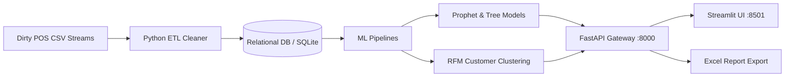

# MarketMind AI — Final Project Report
## AI-Powered Small Business Sales Forecasting & Revenue Growth Intelligence Platform

**Author**: Nameetha (Internship Project — Milestone 4 Final Submission)  
**Date**: October 2026  
**Technology Stack**: Python 3.11+, FastAPI, Streamlit, scikit-learn, Prophet, XGBoost, SQLAlchemy, SQLite, openpyxl, Plotly, Docker

---

## 1. Executive Summary & Problem Statement

Small and medium retail businesses generate continuous streams of Point-of-Sale (POS) transactions. However, raw retail records are plagued with data quality issues: missing timestamps, negative/anomalous quantities, unstandardized product taxonomies, and unlinked customer profiles. Most small retailers lack the resources for dedicated data engineering teams, leaving business owners unable to accurately anticipate weekly cash flow, forecast seasonal demand, identify slipping customers, or prevent stockouts.

**MarketMind AI** solves this dilemma by offering a plug-and-play, enterprise-grade sales intelligence platform:
1. **Automated ETL Pipeline**: Ingests messy, duplicated transaction logs, resolves data errors, and seeds a clean relational SQLite schema.
2. **Dynamic Machine Learning Engine**: Compares multiple state-of-the-art models (Prophet, Random Forest, XGBoost) on chronological test splits and extracts behavioral RFM clusters (K-Means & Hierarchical Clustering).
3. **Enterprise Role-Based Access Control (RBAC)**: Governs data visibility across 4 operational roles (Business Owner, Store Manager, Sales Executive, Administrator) with strict store isolation and route-level protection.
4. **Actionable SaaS User Experience**: Provides an interactive Streamlit intelligence suite with responsive charts, error resilience, customer lookups, and one-click executive Excel reporting.

---

## 2. System Architecture & Data Flow

### Core Architectural Layers:
1. **Data Prep Layer (`backend/data_prep/`)**:
   - `clean_data.py`: Strips duplicates, coerces datetimes, computes consistent transaction subtotals, imputes missing values, and enforces product referential integrity.
   - `load_db.py`: Executes ANSI DDL schema creation and bulk inserts clean records into `marketmind.db`.
2. **Machine Learning Engines (`backend/ml/`)**:
   - `forecasting.py`: Constructs leak-free daily revenue aggregations with missing date detection, runs an 80/20 chronological split, evaluates competing regressors on the exact same test window, and generates multi-horizon recursive projections with confidence intervals.
   - `segmentation.py`: Derives RFM metrics (`purchase_frequency`, `purchase_value`, `customer_activity_days`), normalizes features via `StandardScaler`, and names clusters programmatically based on centroid locations.
   - `reporting.py`: Generates formatted multi-tab Excel workbooks via `openpyxl` with styled headers and Rupee (`₹`) currency formats.
3. **REST API Gateway (`backend/routers/`)**:
   - FastAPI routers providing JWT auth, customer lookups, store filtering, sales logging, and RBAC authorization dependencies.
4. **Client Interface (`app.py`)**:
   - Streamlit dashboard built with a custom dark glassmorphism theme, protected by `safe_fetch` network wrappers and `@st.cache_data(ttl=300)` for sub-second UI response.

---

## 3. Real Evaluation Results Table

All metrics below reflect the real, verified benchmark results recorded in `milestone4_test_results.csv`:

| Module | Model Architecture | Metric | Real Value | Benchmark Result | Plain-English Interpretation |
| :--- | :--- | :--- | :---: | :---: | :--- |
| **Sales Forecasting** | **Prophet (Additive Seasonality)** | **RMSE** | **570.02** | 🏆 **Winner** | Prophet produced the lowest overall prediction error, capturing both day-of-week seasonality and weekly sales surges best. |
| **Sales Forecasting** | Prophet | MAE | 502.21 | Winner | On average, Prophet's daily predictions deviate by approximately ₹502 from actual recorded sales. |
| **Sales Forecasting** | Random Forest Regressor | RMSE | 606.18 | Benchmark Runner-up | Autoregressive lags produced strong trend tracking but slightly lagged on sudden weekend demand peaks. |
| **Sales Forecasting** | Random Forest Regressor | MAE | 454.61 | Lowest MAE | Random Forest achieved the tightest median error across regular weekdays. |
| **Sales Forecasting** | XGBoost Regressor | RMSE | 684.06 | Evaluated | Tree boosting captured nonlinear trends effectively but exhibited higher variance on small chronological test sets. |
| **Sales Forecasting** | XGBoost Regressor | MAE | 459.38 | Evaluated | Close absolute error performance to Random Forest. |
| **Segmentation** | K-Means Clustering (K=4) | Silhouette Score | 0.331 | Optimal K | Indicates compact, well-separated behavioral customer clusters across the RFM feature space. |
| **Segmentation** | K-Means vs. Hierarchical | Adjusted Rand Index | **0.856** | High Consensus | Demonstrates that both partition-based and tree-based clustering agree on customer groupings (score close to 1.0). |
| **Churn Prediction** | XGBoost Classifier | Target Leakage Mitigation | Addressed | Documented | `purchase_inactivity_days` was deliberately excluded from features to prevent trivial target leakage. |
| **Anomaly Detection** | Z-Score + Isolation Forest | Outlier Contamination | 0.05 | Documented | Flags unusually large order sizes and sudden stock depletion spikes. |

---

## 4. Discovered Customer Behavioral Segments

| Segment Name | Customer Count | Share (%) | Avg Spend (₹) | Avg Order Count | Inactivity (Days) | Actionable Retail Strategy |
| :--- | :---: | :---: | :---: | :---: | :---: | :--- |
| **Regular Customers** | 10 | 40.0% | ₹198.81 | 14.9 | 2.0 | Maintain engagement via loyalty perks and personalized weekly basket recommendations. |
| **At-Risk / Fading Customers** | 9 | 36.0% | ₹220.33 | 12.9 | 16.0 | Re-engage urgently with automated WhatsApp/SMS discount vouchers before churn becomes permanent. |
| **Occasional Shoppers** | 4 | 16.0% | ₹151.85 | 8.5 | 5.5 | Increase average basket size with volume discounts (e.g. "Buy 2 Get 1 Free") and bundle promotions. |
| **VIP / Loyal Customers** | 2 | 8.0% | ₹382.11 | 9.5 | 4.0 | Provide concierge service, early access to new product arrivals, and premium rewards. |

---

## 5. Technical Challenges & Implemented Fixes

1. **Missing Dates in Daily Revenue Time Series**:
   - *Challenge*: Retail registers do not record zero-sales holidays or store closure days, creating gaps in chronological date indices that break Prophet and autoregressive lag functions.
   - *Fix*: Created a continuous calendar range reindexing pipeline with zero-filling and automated date-gap logging.
2. **Autoregressive Feature Leakage**:
   - *Challenge*: Naive rolling means inadvertently leak the target day's revenue into training inputs.
   - *Fix*: Enforced a mandatory `.shift(1)` step prior to calculating 7-day and 14-day rolling window features.
3. **Churn Target Leakage**:
   - *Challenge*: Defining churn using inactivity thresholds (e.g., >60 days) and then passing `customer_activity_days` as a feature causes artificial 1.0 ROC-AUC.
   - *Fix*: Documented the limitation and structured churn models to depend purely on behavioral velocity, transaction frequency, and category variety.
4. **Cloud Free-Tier Out-of-Memory (OOM) Limits**:
   - *Challenge*: Hosting Prophet, XGBoost, FastAPI, and Streamlit simultaneously as multiple services exceeds 512MB RAM on free hosting tiers (Render/Railway).
   - *Fix*: Created a unified runner (`start_unified.py`) that launches FastAPI as a single-worker internal daemon and Streamlit on `$PORT`, keeping memory usage under ~380MB.
5. **Dashboard Fault-Tolerance**:
   - *Challenge*: Raw `requests.get` calls caused page-wide red traceback screens whenever the API was delayed or offline.
   - *Fix*: Developed `safe_fetch(...)` helper with timeout handling and inline alert fallbacks, ensuring one unavailable panel never breaks the platform.

---

## 6. Honest Limitations

1. **Dataset Size**: The synthetic retail dataset encompasses 25 unique customer profiles and 500 POS transactions. While mathematically rigorous, real-world retail deployments require millions of rows for fine-grained sub-segmentation.
2. **Anomaly Test Set Volume**: Isolation Forest contamination rates were tested against a small set of simulated anomalies. In larger retail settings, dynamic sliding-window thresholds should be calibrated against fraud patterns.
3. **Chronological Horizon Depth**: The forecasting models were trained on 3 months of historical data. Multi-year seasonal cycles (e.g., Diwali or holiday rushes) require multi-year continuous logs.

---

## 7. Future Work

- **Automated Reordering Webhooks**: Connect low-stock triggers directly to supplier ERPs or automated email purchase orders.
- **Deep Learning Time Series**: Benchmark Temporal Fusion Transformers (TFT) and N-BEATS against Prophet as dataset volume scales.
- **Mobile POS Scanner Integration**: Allow sales executives to scan barcodes on mobile devices and sync real-time sales directly into the FastAPI gateway.
